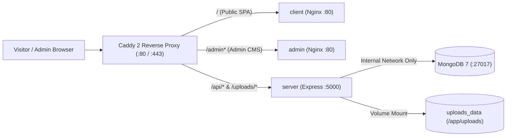

# Architecture Overview (`chinphotos`)

## 1. System Topology

---

## 2. Key Architectural Decisions

1. **Monorepo with npm Workspaces (`client`, `admin`, `server`)**:
   - Strict separation between the public-facing editorial website (`client/`) and the internal studio management CMS (`admin/`).
   - Zero Admin bundle leakage into the public site (`client/` stays fast and SEO-friendly).
2. **Bilingual Content Modeling (`vi` / `en`)**:
   - Primary fields (`title`, `description`, `story`, `location`) store Vietnamese (`vi`) content by default.
   - Optional `*En` fields (`titleEn`, `descriptionEn`, `storyEn`, `locationEn`) store English translations with automatic fallback to Vietnamese when empty.
3. **Dual-Mode Admin Service Layer (`VITE_USE_MOCK`)**:
   - Every service in `admin/src/services/*.service.ts` supports both real HTTP API calls (`axios` with `withCredentials: true`) and deterministic in-memory mock data (`VITE_USE_MOCK=true`) for isolated UI testing.
4. **Image Processing Pipeline**:
   - Uploaded images (`JPG`, `PNG`, `WEBP` up to 15MB) are processed by `Sharp` in `server/src/services/storage.service.ts` into 3 optimized WebP derivatives (`thumb` 400px, `medium` 1200px, `large` 2000px) with EXIF metadata extraction and dominant color / dimensions.
5. **Network Isolation in Production**:
   - `docker-compose.prod.yml` defines two networks: `public` and `internal` (`internal: true`).
   - `mongo` is attached **only** to `internal` and publishes zero ports to the host OS.
